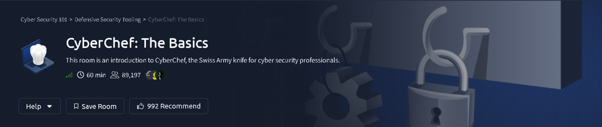
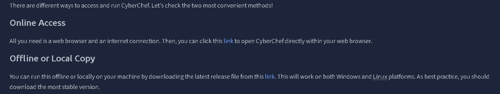
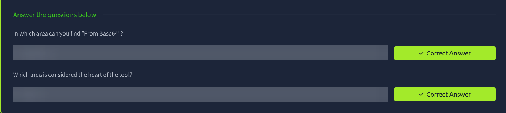
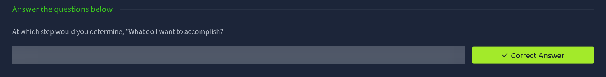
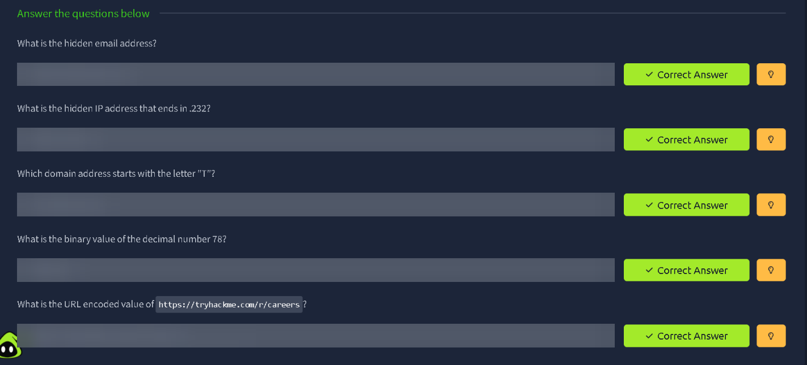
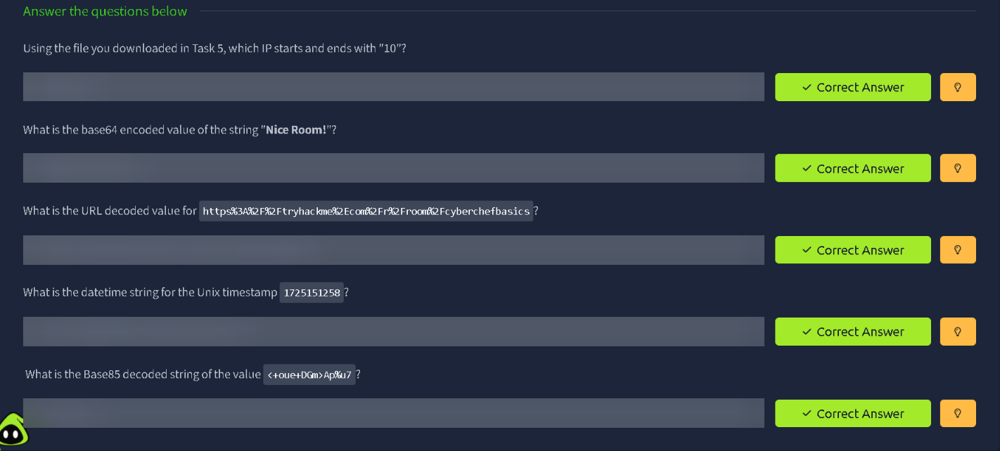

# CyberChef: The Basics — TryHackMe Writeup

| | |
|---|---|
| **Platform** | TryHackMe |
| **Path** | Cyber Security 101 → Defensive Security Tooling |
| **Room** | CyberChef: The Basics |
| **Difficulty / Time** | Easy · ~60 min |
| **Author** | [Shaurya Rathore](https://github.com/shauryarathore357-hub) |
| **Status** | Completed ✅ |

> **Spoiler policy:** every answer field in this writeup is blurred. The goal is to document the *technique* (which operations, in which order, and why), not to hand over answers. If you can follow the method, you can get the answers yourself.

---

## Overview

Defenders constantly run into data that is *wrapped* in something: Base64 blobs in phishing payloads, URL-encoded strings in web logs, Unix timestamps in forensic artifacts, IPs and emails buried in walls of text. **CyberChef**, GCHQ's "Cyber Swiss Army Knife", lets you chain small operations into a repeatable **recipe** that decodes, extracts, and converts data directly in the browser.

This room teaches the interface and the thinking behind recipe-building, then drills it with hands-on exercises.

**Skills practised**

- Navigating the CyberChef interface
- Building and chaining recipes
- Extracting IOCs (IPs, emails, domains) from unstructured text
- Encoding/decoding: Base64, Base85, URL encoding
- Number-base and timestamp conversion

---

## 1. Accessing CyberChef

CyberChef can be used two ways:

| Method | When to use it |
|---|---|
| **Online** | Fastest. Just a browser and an internet connection. |
| **Offline / local copy** | Download the latest *stable* release and open it locally on Windows or Linux. Best practice when handling sensitive data, since nothing leaves your machine. |

> 💡 **Why offline matters:** Pasting real incident data (customer emails, internal IPs) into any web tool is a privacy risk. CyberChef runs client-side, but an offline copy removes the doubt entirely. I downloaded the offline release because a later task requires loading a file.

---

## 2. Understanding the Interface

CyberChef is split into four areas. Knowing where everything lives is half the battle:

| Area | Purpose |
|---|---|
| **Operations** | The searchable library of every available function (decoders, encoders, extractors, hashing, etc.). |
| **Recipe** | The heart of the tool. Operations you drag in here run **top to bottom**, each feeding its output into the next. |
| **Input** | Where your raw data goes (typed, pasted, or loaded from a file). |
| **Output** | The result of running the recipe. |

To locate a specific operation (e.g. *From Base64*), search for it in the Operations panel, or browse its category in the list. Double-click or drag it into the Recipe area to activate it.

---

## 3. Before Anything Else: Thinking Like a Recipe Builder

The room introduces a short methodology before touching the tool. The key habit is to **start with the question, not the operation**:

1. **Define the goal**: *"What do I want to accomplish?"*
2. Look at the input and identify what it is (encoded? mixed text? a number?).
3. Pick the operation(s) that bridge input → goal.
4. Chain them in the right order in the Recipe.
5. Check the output and refine.

The very first step is purely mental: decide what you want out of the data before you pick a single tool. It stops you from random-clicking operations until something looks right.

---

## 4. Practice: Extraction & Encoding

For this task I loaded the provided text file as **Input** using the *Open file as input* button, then built a fresh recipe for each question.

<!-- OPTIONAL: add your own CyberChef recipe screenshot here (Input pane + Recipe pane) -->

### 4.1 Extracting IOCs from a wall of text

The file is a long block of ordinary prose with indicators hidden inside it. Instead of reading it line by line, let CyberChef do the hunting.

| Goal | Operation | Notes |
|---|---|---|
| Find the hidden **email address** | `Extract email addresses` | Output lists every email found. |
| Find the hidden **IP address** ending in `.232` | `Extract IP addresses` | Keep IPv4 selected. Scan the output list for the octet pattern in the question. |
| Find the **domain** starting with a given letter | `Extract domains` | Several domains are returned; pick the one matching the question. |

**Takeaway:** extraction operations turn a needle-in-a-haystack problem into a one-step recipe. This is exactly how analysts pull IOCs out of phishing emails and logs at scale.

### 4.2 Converting a decimal number to binary

**Recipe:** `From Decimal` → `To Binary`

> ⚠️ **Common pitfall:** if you paste `78` and use `To Binary` alone, CyberChef treats it as the *text* "78" (two ASCII characters) and gives you the binary of those characters, not of the number. `From Decimal` first converts the number into a real byte value, and *then* `To Binary` renders that byte as bits.

### 4.3 URL-encoding a string

**Recipe:** `URL Encode`

Tick **Encode all special chars** so that characters such as `:`, `/` and `.` are percent-encoded as well. By default only the characters that *must* be escaped are touched, which gives a different (and, for this question, incorrect) result.

---

## 5. Practice: Decoding & Conversion

<!-- OPTIONAL: add your own CyberChef recipe screenshot here -->

| Question | Recipe | Notes |
|---|---|---|
| Find the IP that starts and ends with `10` (using the file from the extraction task) | `Extract IP addresses` | Same file, same operation. Reusing the input saves time. |
| Base64-encode a string | `To Base64` | Paste the plain string as input. Watch for trailing `=` padding in the output. |
| URL-decode an encoded string | `URL Decode` | Reverses percent-encoding (`%3A` → `:`, `%2F` → `/`, etc.). |
| Convert a Unix timestamp to a readable date | `From UNIX Timestamp` | Unit: **Seconds**. The output is UTC. |
| Decode a Base85 string | `From Base85` | Default alphabet works for this input. |

### Notes on the more interesting ones

- **Unix timestamps** count seconds since 1 Jan 1970 (UTC). They turn up constantly in logs and forensic artifacts, so being able to flip them to human-readable dates instantly is a core DFIR skill. Double-check the unit: a 13-digit value is usually *milliseconds*, not seconds.
- **Base85** is denser than Base64 (about 25% overhead vs. 33%). You'll see it in PDF/PostScript streams and some malware loaders. If `From Base85` returns garbage, the string probably uses a different alphabet; try the alphabet dropdown.
- **Order of operations matters.** If you stack multiple decoders, the Recipe runs top to bottom. If the output looks wrong, try reordering, or use the *disable* toggle on an operation to see where the chain breaks.

---

## Key Takeaways

1. **Recipe = repeatable.** Once you have a working chain, you can save it and reuse it on the next sample.
2. **Start with the goal.** Knowing what you want from the data makes operation choice obvious.
3. **Extraction operations are an analyst's shortcut** for IPs, emails, and domains in messy text.
4. **Encoding ≠ encryption.** Base64, Base85, and URL encoding are trivially reversible and offer zero confidentiality. Attackers use them to *obfuscate*, not to protect.
5. **Details bite.** `From Decimal` before `To Binary`, and "Encode all special chars" on URL Encode, are the kind of small settings that decide whether your output is right.

## Tools Used

- [CyberChef](https://gchq.github.io/CyberChef/) (online + offline copy)

## What's Next

On to the next room in the **Defensive Security Tooling** module. Follow along on [TryHackMe](https://tryhackme.com/p/shauryarathore357) and [GitHub](https://github.com/shauryarathore357-hub).

---

*Writeup by Shaurya Rathore. Answers intentionally redacted. Do the room yourself, it's worth the hour.*
